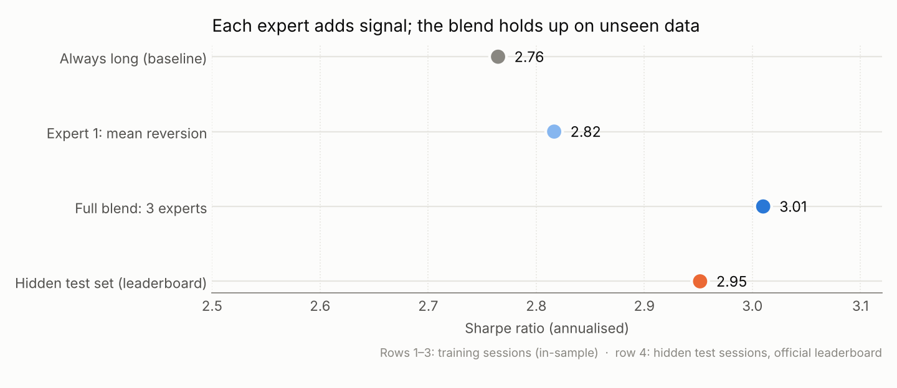
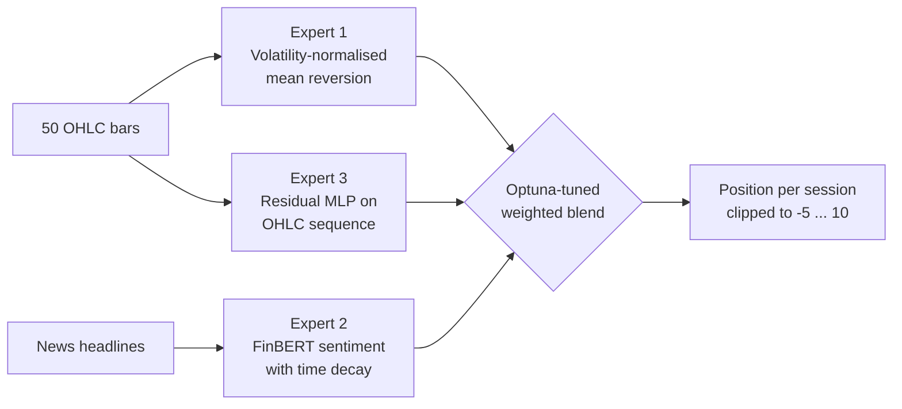

# 📈 ETH Datathon 2026: Multi-Expert Intraday Trading Strategy

**Team Tren-Test-Split's entry to the HRT trading challenge at the ETH Datathon 2026. It blends price action, news sentiment and a neural network into a single position per trading session, and scored a Sharpe ratio of 2.95 on the hidden test set (4th place, 0.065 behind 1st).**

   



## ✨ Key results

| Strategy | Sharpe ratio |
|---|---|
| Always long (baseline, train) | 2.76 |
| Expert 1 only, mean reversion (train) | 2.82 |
| **Full blend of 3 experts (train)** | **3.01** |
| **Hidden test set (official leaderboard)** | **2.95** |

- **4th place on the leaderboard** with 2.952, versus 3.016 for the winning team.
- **Generalisation:** the test score is close to the training score (2.95 vs 3.01), so the blend did not overfit the 1,000 training sessions.

---

## 🎯 The challenge

Each **session** is a short market episode for one asset:

- We see the **first 50 price bars** (open, high, low, close) and the **news headlines** published during them.
- We must choose a **position** (how much to buy or sell) that is held over the **next 50 bars**, which we cannot see.
- The score is the **Sharpe ratio** of the resulting profit and loss across all sessions: return divided by risk.

Data: 1,000 training sessions with their outcomes, and 20,000 test sessions with hidden outcomes.

---

## 🧠 Approach: three experts, one blended position



**Expert 1: volatility-normalised mean reversion.** If the price has risen strongly within the session relative to its own volatility, it tends to partially revert, so we reduce the long position. Volatility is measured with the **Parkinson estimator**, which uses each bar's high–low range:

$$L_D = 1 - \alpha \frac{r}{\sigma_P}, \qquad \sigma_P = \sqrt{\frac{1}{4\ln 2}\,\overline{\ln(H/L)^2}}, \qquad \alpha = 0.07$$

**Expert 2: FinBERT sentiment with time decay.** Each headline is scored by [FinBERT](https://huggingface.co/ProsusAI/finbert), a BERT model fine-tuned on financial text, as P(positive) − P(negative). Recent news counts more, so older headlines decay exponentially:

$$S_{\text{session}} = \sum_{i=1}^{n} \big(P(\text{pos})_i - P(\text{neg})_i\big)\, e^{-\lambda (t_{\text{now}} - t_i)}, \qquad \lambda = 0.175$$

**Expert 3: residual MLP on price shapes.** A small neural network (3 residual blocks, 128 units, GELU, dropout 0.3) takes the 50 seen bars as log-prices relative to the last close and forecasts the path of the next 50 closes. It is trained with **5-fold cross-validation and early stopping**, and the out-of-fold predictions feed the blend without leakage.

**Blending.** The final position is a weighted combination of the three signals:

$$\text{position} = (1-\beta-\gamma)\,L_D + \beta\,S_{\text{session}} + \gamma\,\hat r_{\text{MLP}}$$

The weights β (sentiment) and γ (neural network) are chosen with **Optuna** (400 trials) to maximise the training Sharpe ratio. The neural-network signal is first rescaled to the same spread as the sentiment signal, so the two weights are comparable.

---

## 📁 Repository structure

```
├── strategy.py                 # ▶ full pipeline: data → 3 experts → blend → results/submission.csv
├── scripts/
│   └── baseline_sharpe.py      # reproduces the baseline numbers and the chart above
├── data/README.md              # which competition files to download and where to put them
├── results/submission.csv      # final submitted positions for the 20,000 test sessions
├── figures/                    # chart used in this README
├── pyproject.toml, uv.lock     # dependencies (managed with uv)
└── LICENSE
```

## ▶️ How to run

1. Download the competition data into `data/` (see [data/README.md](data/README.md)).
2. Install the dependencies and run:

```bash
uv venv && source .venv/bin/activate
uv sync
uv run strategy.py                 # writes results/submission.csv
uv run scripts/baseline_sharpe.py  # baseline Sharpe values + figure
```

A GPU is recommended. FinBERT scores are cached in `cache/` after the first run, so later runs are much faster.

## 🔍 Limitations & next steps

- The blend weights are tuned on the same 1,000 training sessions used to report the 3.01, so that number is optimistic. The 2.95 on unseen sessions is the honest estimate.
- Nested cross-validation for the blend weights, or a held-out set of sessions, would give a cleaner model-selection signal.
- The experts could be extended to vary their weights by volatility regime instead of using one global blend.

## 👥 Team & credits

Built in a team of four at the **ETH Datathon 2026** (organised by the ETH Analytics Club), HRT challenge: **Andreas Spanopoulos · Andrea Romanò · Andreas · Charis**.

